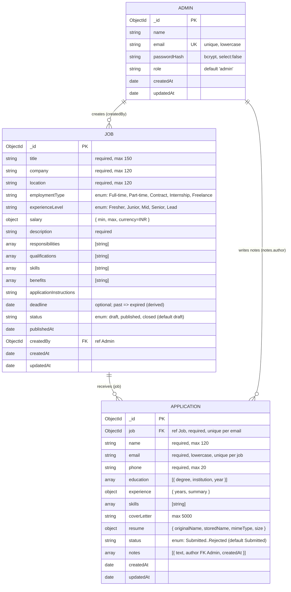

# CareerTrack Database Schema

- **Database name:** `careertrack` (from the `MONGO_URI` connection string; tests use a throwaway in-memory database)
- **ORM:** Mongoose 8, `strictQuery: true`
- **Collections:** `admins`, `jobs`, `applications`
- Mongoose adds `createdAt` / `updatedAt` automatically (timestamps: true) to every collection.

## Relationships

One **Admin** creates many **Jobs** (`job.createdBy` → `admin._id`).
One **Job** receives many **Applications** (`application.job` → `job._id`).
Applications embed the candidate's education, experience, notes and résumé metadata as subdocuments — they are only meaningful inside one application and are never queried independently.



## Indexes

| Collection | Index | Purpose |
|---|---|---|
| `admins` | `{ email: 1 }` unique | login lookup + duplicate prevention |
| `jobs` | `{ title: 'text', company: 'text', location: 'text' }` | text search (kept for future `$text` use) |
| `jobs` | `{ status: 1, deadline: 1 }` | active-job filter + expiry checks |
| `jobs` | `{ createdAt: -1 }` | newest-first lists |
| `applications` | `{ job: 1 }` | job → applications lookups, delete-block count |
| `applications` | `{ job: 1, email: 1 }` **unique** | duplicate-application prevention (409 on violation) |
| `applications` | `{ status: 1, createdAt: -1 }` | status-filtered, newest-first admin lists |

## "Expired" is derived, never stored

A job is **active** when `status === 'published'` AND (`deadline` is empty OR `deadline >= now`).
The single helper `activeJobFilter()` (backend/src/config/constants.js) builds this filter and is used by the public list, public detail, apply endpoint and dashboard stats — so no stored flag can ever drift out of sync.

## Validation rules

**Schema level (Mongoose):**
- Required: job `title`/`company`/`location`/`description`, application `job`/`name`/`email`/`phone`/`resume`, admin `name`/`email`/`passwordHash`
- Enums: `status`, `employmentType`, `experienceLevel` from one shared constants file
- Application `experience.years >= 0`; education year is a Number
- Job `salary.max >= salary.min` via a document validator

**Request level (express-validator, every write endpoint):** required fields, email format, phone format, string lengths, array sizes, ISO dates, ObjectId format, status enums. Failures return `400 { success:false, message, errors:[{field,message}] }`.

**Duplicate handling:** the controller pre-checks `Application.findOne({ job, email })` for a friendly message, and the unique index (`error.code 11000`) is the second line of defence — mapped to `409` by the central error handler.

## Anonymized sample documents

```jsonc
// jobs
{
  "_id": "665f1a...",
  "title": "Frontend Developer",
  "company": "TechNova Solutions",      // fictional
  "location": "Bengaluru, Karnataka",
  "employmentType": "Full-time",
  "experienceLevel": "Junior",
  "salary": { "min": 450000, "max": 700000, "currency": "INR" },
  "description": "Build responsive React interfaces for a fictional SaaS dashboard.",
  "responsibilities": ["Build reusable React components"],
  "qualifications": ["B.Tech/BCA or equivalent"],
  "skills": ["React", "JavaScript", "Tailwind CSS"],
  "benefits": ["Health insurance"],
  "applicationInstructions": "Apply through this portal with your latest résumé.",
  "deadline": null,
  "status": "published",
  "publishedAt": "2026-11-08T10:00:00.000Z",
  "createdBy": { "_id": "665f0...", "name": "Demo Admin" },
  "createdAt": "2026-11-08T10:00:00.000Z",
  "updatedAt": "2026-11-08T10:00:00.000Z"
}

// applications
{
  "_id": "665f2b...",
  "job": "665f1a...",
  "name": "Ravi Kumar",                  // fake test data
  "email": "ravi.kumar@example.com",
  "phone": "+91 98765 43210",
  "education": [{ "degree": "B.Tech CSE", "institution": "Demo University", "year": 2023 }],
  "experience": { "years": 2, "summary": "Built MERN demo apps." },
  "skills": ["React", "Node.js"],
  "coverLetter": "I would love to join.",
  "resume": {
    "originalName": "ravi-resume.pdf",
    "storedName": "a3f5c9e2-8b1d-4c6e-9f0a-7d2b5e8c1a4f.pdf",  // random UUID - original name never touches disk
    "mimeType": "application/pdf",
    "size": 54102
  },
  "status": "Shortlisted",
  "notes": [{ "text": "Strong React portfolio.", "author": "665f0...", "createdAt": "2026-11-08T11:30:00.000Z" }],
  "createdAt": "2026-11-08T11:00:00.000Z",
  "updatedAt": "2026-11-08T11:30:00.000Z"
}
```

Résumé **files** live on disk at `backend/uploads/resumes/<storedName>` (gitignored) — the database only stores metadata. Files are streamed exclusively through the protected admin route, never statically served.
