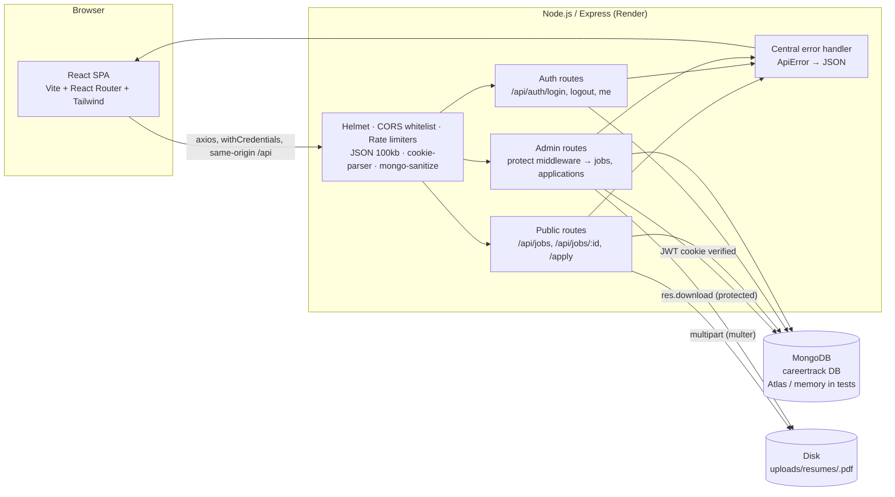

# Report Notes — factual material for the project report

> Everything below describes what is ACTUALLY implemented in this repository (backend/ + frontend/). Where a limitation exists, it is stated.

## 1. Architecture & Data Flow

Two deployable units, one database:

Request lifecycle (example — apply):
1. Vite proxy (dev) / Vercel rewrite (prod) delivers the request same-origin to Express.
2. Security middleware runs: helmet headers, CORS check, general rate limit, 100kb JSON cap, cookie parse, mongo-sanitize, body prototype normalization.
3. Route chain: apply rate limiter → ObjectId validation → multer saves the file with a random UUID name → field validation → controller (job active check → duplicate pre-check → magic-byte check → create).
4. A router-level cleanup guard deletes any saved file if a later step fails; the central error handler maps every error type to the standard JSON shape.

## 2. Design Decisions (and why)

- **Express 4, not 5** — `express-mongo-sanitize` mutates `req.query`, which Express 5 makes a read-only getter. Express 4 keeps the documented security middleware stack working.
- **JWT in an httpOnly cookie** (not localStorage) — an XSS payload cannot read the token; `SameSite` + CSRF-safe methods (no state-changing GETs) cover the rest. Production cookies are `Secure`.
- **"Expired" derived, not stored** — one `activeJobFilter()` helper is used by every consumer (list, detail, apply, stats). A stored "expired" flag could drift from the clock; a derived filter cannot.
- **Delete blocked when applications exist (409)** — applications reference the job; deletion would orphan candidate data. Closing achieves the business goal ("stop accepting applications") without data loss. The API message says exactly that.
- **Résumé filename = random UUID + extension** — the visitor's filename is stored for display only (`resume.originalName`); path traversal via crafted filenames is structurally impossible.
- **Multipart-only fields travel flat** — `skills` as a comma string and `education` as a JSON-encoded array, because FormData has no nested-object syntax. Documented in the API docs and mirrored by the client.
- **Deadline/salary sort via `$ifNull`** — jobs without a deadline sort last (soonest deadline first), jobs without salary sort last (highest max first). Plain sorts would put missing values first, which looks broken in the UI.
- **Rate limits raised in test env** (except login) — otherwise 20+ Supertest requests from one IP would trip the apply limiter and make the suite flaky. The login limiter stays strict because a test exercises it deliberately.
- **PUT = full replacement** — the update endpoint validates the complete payload (required fields enforced); the edit form always sends the full object.

## 3. Security Measures (all implemented)

| Measure | Where |
|---|---|
| helmet security headers | app.js |
| CORS whitelist with credentials (never `*`) | app.js + CLIENT_ORIGIN |
| General (100/15min), login (10/15min) and apply (10/hour) rate limiters | middleware/rateLimiters.js |
| JSON body cap 100kb | app.js |
| express-mongo-sanitize on body/params/query + prototype normalization | app.js, middleware/normalizeBody.js |
| Regex-escaped search text (no regex injection) | utils/regex.js |
| bcrypt cost 12, passwordHash `select: false` | models/Admin.js |
| Generic "Invalid credentials" (no username enumeration) | controllers/authController.js |
| httpOnly + Secure(prod) + SameSite cookie | authController cookieOptions |
| `protect` middleware on every admin route + résumé stream | middleware/auth.js, routes |
| ObjectId validation on every `:id` param | route validators |
| Public job responses use explicit field selection (no `createdBy`) | jobController |
| Upload validation: extension → MIME hint → magic bytes; UUID filenames; never statically served | middleware/upload.js, utils/fileSignature.js |
| Orphaned-upload cleanup on every failure path | routes cleanup guard + utils |
| Central error handler; no stack traces in production | middleware/errorHandler.js |
| Fail-fast startup when MONGO_URI/JWT_SECRET missing | server.js |
| CSV formula-injection guard (`= + - @` prefixed) | utils/csv.js |

## 4. File Upload Handling

Flow: browser sends `multipart/form-data` → multer `diskStorage` writes to `UPLOAD_DIR` (backend/uploads/resumes, gitignored, outside any static folder) with name `<crypto.randomUUID()>.<ext>` → three validation layers (extension whitelist → MIME hint → magic bytes: `%PDF` / `PK\x03\x04`) → application record stores metadata → download via `res.download` on a protected route, with the on-disk name pattern re-verified before touching the filesystem.

Failure handling: any failure after the file was saved (validation, duplicate 409, magic bytes) triggers the router-level cleanup guard that unlinks the file before the error response. Verified by tests TC-A05/A07/A08/A15 (file counts on disk are asserted).

## 5. Challenges & Solutions (encountered during the real build)

1. **multer 2 + express-validator crash (500)** — multer 2 returns null-prototype `req.body` objects and mongo-sanitize leaves null-prototype objects too; express-validator's string sanitizers throw `Cannot convert object to primitive value` on them. Solved with `normalizeBody` middleware that rebuilds the body as JSON-safe objects — used after sanitize (app-wide) and after multer (apply route). Caught by the injection tests; without them this would have been a live 500 bug.
2. **Magic-byte check lost in refactor** — during a reorder, the signature-check call was accidentally dropped and fake PDFs (renamed .exe) were accepted. The test suite caught it immediately — the reason the suite exists.
3. **Logout vs stateless JWT** — clearing the cookie does not revoke the token; short expiry is the mitigation. Documented as a limitation with the Redis-blocklist future fix.
4. **Sorting jobs without deadlines** — plain `sort { deadline: 1 }` puts them first; solved with an aggregation branch using `$ifNull` + a far-future placeholder.
5. **Windows dev environment** — npm's allow-scripts policy blocked postinstall scripts (esbuild, mongodb-memory-server); both have lazy fallbacks, verified by the build and test runs.

## 6. Limitations (honest)

- Render free-tier disk is **ephemeral** — uploaded résumés vanish on redeploy/restart. Production fix: Cloudinary/S3 with signed URLs.
- JWT revocation absent (see above). Rate-limit counters are in-memory (single-instance only).
- Frontend testing is manual (checklist in Test_Cases.xlsx) — no automated UI/browser tests.
- The frontend mirrors the backend enum constants in `src/utils/constants.js` (kept in sync manually).
- Text index on jobs exists but search uses case-insensitive regex (escaped); switching to `$text` would change scoring behaviour and is noted as future work.

## 7. Verification Performed (evidence)

- `npm test` (backend): **76/76 passing** across 6 suites (jobs, apply, auth, authorization, admin jobs, admin applications).
- `npm run build` (frontend): Vite production build succeeds (124 modules).
- Live full-stack check: in-memory MongoDB + seeded admin/12 jobs + API server + Vite dev server; verified health, public list (8 active of 9 published + 1 expired), login → cookie → me → stats → admin list, apply with real PDF → 201, duplicate → 409, status update → Shortlisted, note with author, CSV export headers, résumé download byte-exact, 401 without cookie.
